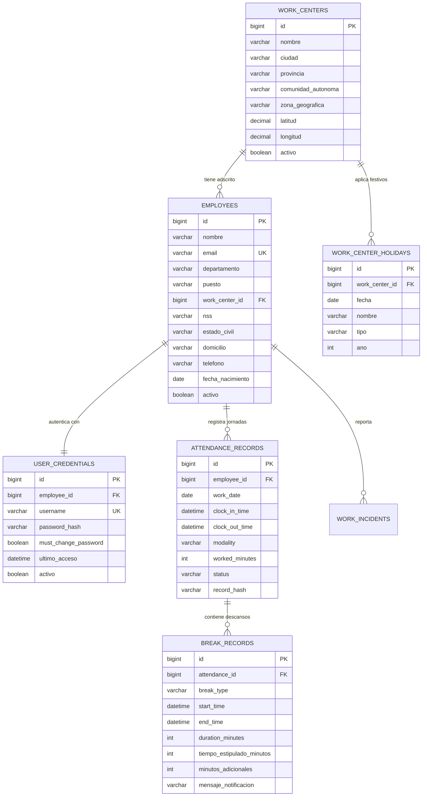

# 🏢 Tracker Treball Enterprise

> **Plataforma Integral de Control Horario, Gestión de Personal, Auditoría de Pausas y Prevención de Riesgos Laborales (PRL)**  
> Conforme al **Real Decreto-ley 8/2019** de registro de jornada obligatorio en España.

**Autor:** Hassan Adraou  
**Versión:** 2.1.0 (Enterprise Edition)  
**Estado de Despliegue:** 🟢 Activo en Producción (**Frontend en Vercel** + **Backend en Railway** + **Base de Datos MySQL en Railway**)

---

## 📑 Tabla de Contenidos

1. [Visión General del Proyecto](#1-visión-general-del-proyecto)
2. [Arquitectura y Stack Tecnológico](#2-arquitectura-y-stack-tecnológico)
3. [Estructura del Proyecto](#3-estructura-del-proyecto)
4. [Modelo de Datos y Base de Datos (MySQL)](#4-modelo-de-datos-y-base-de-datos-mysql)
   * [Diagrama Entidad-Relación (ERD)](#diagrama-entidad-relación-erd)
   * [Descripción de Tablas Principales](#descripción-de-tablas-principales)
5. [Lógica de Negocio y Casos de Uso](#5-lógica-de-negocio-y-casos-de-uso)
   * [Máquina de Estados de la Jornada](#máquina-de-estados-de-la-jornada)
   * [Control Estricto de Pausas y Cómputo de Exceso (Overtime)](#control-estricto-de-pausas-y-cómputo-de-exceso-overtime)
   * [Centros de Trabajo y Festivos Geográficos](#centros-de-trabajo-y-festivos-geográficos)
   * [Autenticación BCrypt y Gestión de Credenciales](#autenticación-bcrypt-y-gestión-de-credenciales)
   * [Smart Work Assistant y Recordatorios en Vivo](#smart-work-assistant-y-recordatorios-en-vivo)
6. [Catálogo de APIs REST](#6-catálogo-de-apis-rest)
7. [Batería de Pruebas Automatizadas (33/33 Tests)](#7-batería-de-pruebas-automatizadas-3333-tests)
8. [Guía de Despliegue en Producción](#8-guía-de-despliegue-en-producción)
   * [Paso 1: Base de Datos MySQL en Railway](#paso-1-base-de-datos-mysql-en-railway)
   * [Paso 2: Backend Spring Boot en Railway](#paso-2-backend-spring-boot-en-railway)
   * [Paso 3: Frontend en Vercel](#paso-3-frontend-en-vercel)
9. [Puesta en Marcha Local](#9-puesta-en-marcha-local)
10. [Credenciales Demo de Acceso](#10-credenciales-demo-de-acceso)

---

## 1. Visión General del Proyecto

**Tracker Treball** es una solución web empresarial diseñada para solventar la gestión operativa de recursos humanos, registro de asistencia diaria y cumplimiento normativo laboral.

### Capacidades Destacadas:
* **Cumplimiento Legal RDL 8/2019:** Registro inmutable de hora de entrada, pausas y salida, sellado mediante huella criptográfica **SHA-256**.
* **Gestión de Sedes (Centros de Trabajo):** Adscripción obligatoria de cada empleado a un único centro de trabajo: **Barcelona, Madrid, Bilbao, Sevilla, Valencia o Extranjero**.
* **Calendarios Laborales Geográficos:** Cómputo automático de festivos nacionales, autonómicos y locales según el centro asignado.
* **Control de Excesos en Descansos:** Detección en tiempo real de descansos que superen el tiempo estipulado (15 min café, 30 min descanso, 60 min comida, 5 min visual PRL). Generación de alertas automáticas y cómputo de horas extraordinarias en reportes semanales y mensuales.
* **Seguridad Empresarial:** Autenticación con usuario y contraseña cifrada con algoritmo **BCrypt**, autogeneración de claves al crear nuevos empleados y cambio de contraseña por el propio usuario.
* **Smart Work Assistant:** Asistente interactivo con Bento Grid (Figma) con tiempo meteorológico en la sede, estado de tráfico, recordatorios ergonómicos PRL, reuniones y felicitaciones de cumpleaños.

---

## 2. Arquitectura y Stack Tecnológico

El proyecto está diseñado bajo una arquitectura desacoplada de microservicios y Single Page Application (SPA), garantizando alta disponibilidad, seguridad y bajo acoplamiento:

```
┌────────────────────────────────────────────────────────┐
│                   CLIENTE / NAVEGADOR                  │
│   (HTML5, CSS3 Figma Bento Grid, JS ES6+, i18n Bilingüe)│
└───────────────────────────┬────────────────────────────┘
                            │ HTTPS / REST (JSON)
                            ▼
┌────────────────────────────────────────────────────────┐
│                  FRONTEND (Vercel)                     │
│  URL: https://tracker-treball-frontend.vercel.app      │
└───────────────────────────┬────────────────────────────┘
                            │ CORS / JSON API
                            ▼
┌────────────────────────────────────────────────────────┐
│               BACKEND (Railway PaaS)                   │
│  Spring Boot 3.2.x (Java 17 OpenJDK / Docker Alpine)   │
│  - Spring Security (BCrypt PasswordEncoder)           │
│  - Spring Data JPA / Hibernate ORM                     │
│  - HikariCP Connection Pool                            │
│  URL: https://tracker-treball-backend-production-e9cd.up.railway.app
└───────────────────────────┬────────────────────────────┘
                            │ Red Privada Railway (mysql.railway.internal:3306)
                            ▼
┌────────────────────────────────────────────────────────┐
│             BASE DE DATOS (Railway MySQL 8)            │
│  InnoDB Engine, UTF-8 MB4, Índices relacionales        │
└────────────────────────────────────────────────────────┘
```

### Tecnologías Empleadas:

| Capa | Tecnología | Propósito |
| :--- | :--- | :--- |
| **Frontend** | HTML5 Semántico + CSS3 Modular | Interfaz de usuario adaptada a Figma (Bento Grid, modo oscuro/claro) |
| **Frontend Logic** | JavaScript Moderno (ES6+) | Gestión de estado reactivo, timers de jornada y cliente API REST |
| **Backend Framework** | Spring Boot 3.2.x (Java 17) | API REST empresarial con Arquitectura Hexagonal y DTOs |
| **ORM & Persistencia** | Spring Data JPA / Hibernate | Mapeo objeto-relacional y consultas optimizadas |
| **Seguridad** | Spring Security Crypto | Algoritmo BCrypt con salt criptográfico para contraseñas |
| **Base de Datos** | MySQL 8.0 (Railway) | Motor de base de datos relacional con claves foráneas e integridad referencial |
| **Contenedores** | Docker (Multi-stage build) | Empaquetado ligero en imagen Alpine JRE 17 |
| **Hosting Cloud** | Vercel & Railway | Despliegue continuo (CI/CD) conectado a GitHub |

---

## 3. Estructura del Proyecto

```text
Tracker-Treball/
├── backend/                               <-- Servicios del Backend (Spring Boot 3)
│   ├── src/main/java/com/trackertreball/
│   │   ├── config/                        <-- CorsConfig, SecurityConfig, LocaleConfig
│   │   ├── controller/                    <-- AttendanceController, AuthController, EmployeeController, etc.
│   │   ├── model/                         <-- Employee, UserCredential, WorkCenter, AttendanceRecord, BreakRecord, etc.
│   │   ├── repository/                    <-- Interfaces JpaRepository para MySQL
│   │   ├── service/                       <-- AttendanceService, AuthService, DashboardService, ReminderService, etc.
│   │   └── TrackerTreballApplication.java <-- Clase principal de arranque Spring Boot
│   ├── src/main/resources/
│   │   ├── application.properties         <-- Configuración datasource, pool de conexiones y perfiles
│   │   └── messages*.properties           <-- Mensajes bilingües (Catalán / Castellano)
│   ├── Dockerfile                         <-- Construcción multi-etapa optimizada para Railway
│   └── pom.xml                            <-- Dependencias Maven (Spring Boot, MySQL Driver, Security, etc.)
│
├── frontend/                              <-- Interfaz de Usuario Web
│   ├── assets/                            <-- Logotipos oficiales e iconos corporativos
│   ├── css/
│   │   └── estilos.css                    <-- Estilos Figma, variables CSS, Bento Grid y responsivo
│   ├── js/
│   │   ├── api.js                         <-- Cliente HTTP con cabeceras de autorización Bearer
│   │   └── app.js                         <-- Controlador de vistas, timers de jornada, pausas y eventos DOM
│   └── index.html                         <-- Estructura semántica de la aplicación SPA
│
├── database/                              <-- Scripts SQL y Migraciones
│   ├── 01_schema_tracker_treball.sql      <-- DDL: Estructura de tablas e índices
│   ├── 02_data_seed_tracker_treball.sql   <-- DML: Inserción de 21 empleados corporativos
│   ├── 03_railway_backup_tracker_treball.sql <-- Backup de contingencia para Railway
│   └── 04_enhanced_tracker_treball.sql    <-- Migración avanzada: centros, festivos y credenciales BCrypt
│
├── tests/                                 <-- Batería de Pruebas Automatizadas
│   └── attendance_e2e_suite.js            <-- Suite de pruebas E2E (33 casos de uso cubiertos)
│
└── README.md                              <-- Especificación Técnica Completa
```

---

## 4. Modelo de Datos y Base de Datos (MySQL)

### Diagrama Entidad-Relación (ERD)



### Descripción de Tablas Principales

| Tabla | Propósito | Campos Clave |
| :--- | :--- | :--- |
| `work_centers` | Define los 6 centros de trabajo oficiales de la empresa. | `nombre`, `ciudad`, `comunidad_autonoma`, `latitud`, `longitud` |
| `employees` | Directorio de empleados con información contractual y personal. | `nss`, `estado_civil`, `domicilio`, `work_center_id` (FK única) |
| `user_credentials` | Seguridad y credenciales de acceso cifradas. | `username`, `password_hash` (BCrypt), `must_change_password` |
| `attendance_records` | Fichajes diarios de entrada y salida (RDL 8/2019). | `work_date`, `clock_in_time`, `clock_out_time`, `worked_minutes`, `status`, `record_hash` (SHA-256) |
| `break_records` | Registro de pausas laborales con auditoría de exceso. | `break_type`, `tiempo_estipulado_minutos`, `minutos_adicionales`, `mensaje_notificacion` |
| `work_center_holidays` | Festivos clasificados por ámbito (Nacional, Autonómico, Local). | `fecha`, `nombre`, `tipo`, `work_center_id` (NULL = Nacional) |

---

## 5. Lógica de Negocio y Casos de Uso

### Máquina de Estados de la Jornada

```text
  [No Iniciada]
        │
        ▼  POST /attendance/clock-in
    [ OPEN ] ◄─────────────────────────┐
        │                              │
        ├──► POST /attendance/break/start
        │           │                  │
        │           ▼                  │
        │      [ EN PAUSA ]            │
        │           │                  │
        │           └──► POST /attendance/break/finish
        │
        ▼  POST /attendance/clock-out
    [ CLOSED ] (Sellado criptográfico SHA-256)
```

1. **Entrada (`clockIn`):** 
   * Valida que no exista una jornada `OPEN` en el día para ese empleado.
   * Crea el registro con marca temporal exacta `now()` y modalidad (`PRESENCIAL`, `TELETRABAJO`).
2. **Pausas (`startBreak` / `finishBreak`):**
   * Modalidades estipuladas: **Café (15 min)**, **Descanso (30 min)**, **Almuerzo (60 min)** y **PRL Visual (5 min)**.
   * Solo puede haber una pausa abierta a la vez vinculada a la jornada activa.
3. **Salida (`clockOut`):**
   * Si había una pausa abierta, la finaliza automáticamente.
   * Calcula: $\text{Minutos Netos} = \text{Tiempo Bruto} - \sum \text{Minutos de Pausa}$.
   * Si $\text{Minutos Netos} > 480$ (8 horas), computa las horas extraordinarias.
   * Genera la firma SHA-256 inmutable de la jornada.

### Control Estricto de Pausas y Cómputo de Exceso (Overtime)
Cuando un trabajador finaliza una pausa:
$$\text{Minutos Adicionales} = \max(0, \text{Duración Real} - \text{Tiempo Estipulado})$$
* **Si $\text{Exceso} > 0$:**
  * El backend genera el mensaje de advertencia:
    > *"Has consumido X minutos de pausa (Y minutos adicionales sobre los Z permitidos)."*
  * Se emite una alerta visual en el navegador.
  * Se suma al acumulador de tiempo adicional en el reporte semanal y mensual.
* **Formato de visualización:** El tiempo adicional se expresa de forma transparente en horas y minutos (ej. `1 h 15 min`).

### Centros de Trabajo y Festivos Geográficos
Cada empleado está vinculado obligatoriamente a una de las 6 sedes:
1. **Barcelona:** Sede Noreste (Cataluña). Festivos específicos: Sant Joan, Diada Nacional de Catalunya, La Mercè, Sant Esteve.
2. **Madrid:** Sede Centro. Festivos específicos: Fiesta de la Comunidad de Madrid, San Isidro.
3. **Bilbao:** Sede Norte (País Vasco). Festivos específicos: Lunes de Pascua, Santiago Apóstol.
4. **Sevilla:** Sede Sur (Andalucía). Festivos específicos: Día de Andalucía, Corpus Christi.
5. **Valencia:** Sede Levante (Comunitat Valenciana). Festivos específicos: San José, Día de la Comunitat Valenciana.
6. **Extranjero:** Sede Internacional (Francia / Europa). Calendario internacional.

### Autenticación BCrypt y Gestión de Credenciales
* **Alta de empleado:** Al crear un trabajador en la base de datos, el servicio `AuthService` genera una contraseña aleatoria criptográficamente segura de 12 caracteres (con mayúsculas, minúsculas, dígitos y símbolos) y la cifra con **BCrypt**.
* **Primer inicio de sesión:** La contraseña autogenerada se muestra al administrador para su entrega segura.
* **Cambio de clave:** Desde el modal de perfil (`#modal-profile`), el empleado puede actualizar su clave en cualquier momento validando su clave actual y estableciendo la nueva (mínimo 8 caracteres).

### Smart Work Assistant y Recordatorios en Vivo
El Dashboard incorpora tarjetas Bento Grid alimentadas por la API REST:
* **Clima en Tiempo Real:** Muestra la temperatura y condición meteorológica de la ciudad de la sede asignada.
* **Próximo Festivo:** Calcula la fecha y los días restantes hasta el siguiente día festivo de su centro.
* **Pausa Ergonómica Recomendada:** Sugerencia horaria para descansos visuales preventivos.
* **Cumpleaños del Equipo:** Detecta si algún compañero de la plantilla cumple años en los próximos 7 días para felicitarle.
* **Reunión Programada:** Notificación de la próxima reunión técnica o de proyecto.

---

## 6. Catálogo de APIs REST

Todos los endpoints están prefijados bajo `/api/v1`:

### 🔐 Autenticación
| Método | Endpoint | Parámetros / Cuerpo | Descripción |
| :--- | :--- | :--- | :--- |
| `POST` | `/auth/login` | `{ "email": "...", "password": "..." }` | Autenticación con BCrypt y emisión de token. |
| `POST` | `/auth/change-password` | `{ "email": "...", "currentPassword": "...", "newPassword": "..." }` | Modificación de contraseña por el usuario. |

### 👥 Directorio de Empleados
| Método | Endpoint | Parámetros / Cuerpo | Descripción |
| :--- | :--- | :--- | :--- |
| `GET` | `/employees` | - | Listado completo de empleados con sede y NSS. |
| `GET` | `/employees/{id}` | - | Detalle de la ficha contractual de un empleado. |
| `POST` | `/employees` | `{ "nombre": "...", "email": "...", "workCenterId": 1, ... }` | Alta de empleado + autogeneración de contraseña. |
| `PUT` | `/employees/{id}` | `{ "nombre": "...", "puesto": "...", ... }` | Actualización de perfil o datos de contacto. |

### ⏱️ Control Horario y Pausas
| Método | Endpoint | Parámetros / Cuerpo | Descripción |
| :--- | :--- | :--- | :--- |
| `GET` | `/attendance/today` | `?employeeId={id}` | Estado de la jornada de hoy (OPEN, CLOSED o NO_INICIADA). |
| `POST` | `/attendance/clock-in` | `?employeeId={id}&modality={mod}` | Fichaje de entrada e inicio de jornada. |
| `POST` | `/attendance/break/start` | `?employeeId={id}&breakType={tipo}&minutes={min}` | Inicia descanso con límite de tiempo estipulado. |
| `POST` | `/attendance/break/finish`| `?employeeId={id}` | Finaliza descanso, audita exceso y notifica. |
| `POST` | `/attendance/clock-out` | `?employeeId={id}` | Cierre de jornada, cálculo de horas y hash SHA-256. |
| `GET` | `/attendance/reports/employee/{id}` | - | Reporte semanal/mensual con tiempo adicional consumido. |

### 🏢 Centros de Trabajo y Festivos
| Método | Endpoint | Parámetros / Cuerpo | Descripción |
| :--- | :--- | :--- | :--- |
| `GET` | `/work-centers` | - | Listado de los 6 centros de trabajo oficiales. |
| `GET` | `/work-centers/{id}/holidays` | - | Calendario oficial de festivos según centro y geografía. |

### 📊 Dashboard y Recordatorios
| Método | Endpoint | Parámetros / Cuerpo | Descripción |
| :--- | :--- | :--- | :--- |
| `GET` | `/dashboard/assistant` | `?employeeId={id}` | Bento Grid: jornada, desplazamiento, proyectos y clima. |
| `GET` | `/reminders/employee/{id}` | - | Recordatorios: próximo festivo, pausas, clima y cumpleaños. |

---

## 7. Batería de Pruebas Automatizadas (33/33 Tests)

El proyecto incluye una suite de pruebas End-to-End (`attendance_e2e_suite.js`) que verifica todos los casos de uso en vivo contra la base de datos y backend en producción.

### Para ejecutar las pruebas:
```bash
node Tracker-Treball/tests/attendance_e2e_suite.js
```

### Casos Evaluados:
* **Caso 1:** Autenticación válida, tokens, asignación de centros y bloqueo con claves erróneas (6 tests).
* **Caso 2:** Validación de los 6 centros únicos oficiales y festivos geográficos autonómicos/locales (4 tests).
* **Caso 3:** Integridad del directorio de 21 empleados corporativos, NSS y domicilios (2 tests).
* **Caso 4:** Creación de empleado en BD, verificación de clave generada y login inmediato (2 tests).
* **Caso 5:** Ciclo completo de fichaje: entrada, rechazo de doble entrada, apertura de pausa, cómputo de exceso, salida y firma SHA-256 (7 tests).
* **Caso 6:** Auditoría de reportes semanales y mensuales con apartado de tiempo adicional consumido en horas y minutos (5 tests).
* **Caso 7:** Asistente del Dashboard, estado en tiempo real, cálculo meteorológico y cumpleaños (6 tests).
* **Caso 8:** Validación de seguridad en cambio de contraseña y rechazo ante clave antigua incorrecta (1 test).

**Resultado:** `33 APROBADAS | 0 FALLIDAS (100% SUCCESS)`

---

## 8. Guía de Despliegue en Producción

### Paso 1: Base de Datos MySQL en Railway
1. Crear un nuevo servicio en [Railway](https://railway.app/) seleccionando la plantilla **MySQL**.
2. En la pestaña **Variables**, configurar:
   * `MYSQLDATABASE`: `railway`
   * `MYSQLUSER`: `root`
   * `MYSQLPASSWORD`: `<tu_contraseña_segura>`
   * `MYSQL_ROOT_HOST`: `%` *(permite conexiones desde proxies y la red interna)*
3. En la pestaña **Settings** $\to$ **Networking**, habilitar **TCP Proxy** para obtener host y puerto público (ej. `tramway.proxy.rlwy.net:10302`).
4. Importar el script completo de inicialización:
   ```bash
   mysql -h <TCP_HOST> -u root -p<PASSWORD> --port <TCP_PORT> railway < database/04_enhanced_tracker_treball.sql
   ```

### Paso 2: Backend Spring Boot en Railway
1. En el mismo proyecto de Railway, añadir un nuevo servicio desde el repositorio GitHub: `https://github.com/Adraouha/tracker-treball-backend.git`.
2. Railway detectará automáticamente el archivo [Dockerfile](file:///c:/Users/adrao/Desktop/EEBO%20-%201r_A/EEBO/CURSO%20IRONHACK/Tracker-Treball/backend/Dockerfile) multi-etapa con Maven y OpenJDK 17.
3. Configurar las **Variables de Entorno** del backend:
   ```properties
   DB_URL=jdbc:mysql://mysql.railway.internal:3306/railway?useSSL=false&allowPublicKeyRetrieval=true&serverTimezone=UTC
   DB_USER=root
   DB_PASSWORD=<tu_contraseña_segura>
   PORT=8080
   CORS_ORIGINS=*
   ```
4. Generar dominio público en **Networking** (ej. `tracker-treball-backend-production-e9cd.up.railway.app`).

### Paso 3: Frontend en Vercel
1. Iniciar sesión en [Vercel](https://vercel.com/) e importar el repositorio: `https://github.com/Adraouha/tracker-treball-frontend.git`.
2. Framework Preset: **Other** / **Static Site** (directorio raíz `./`).
3. El frontend ya incluye en [api.js](file:///c:/Users/adrao/Desktop/EEBO%20-%201r_A/EEBO/CURSO%20IRONHACK/Tracker-Treball/frontend/api.js) la URL fija de producción del backend en Railway.
4. Desplegar. Vercel desplegará la web en CDN global con soporte HTTPS automático.

---

## 9. Puesta en Marcha Local

### Modo Desarrollo Rápido (con Mock Server Node.js):
```bash
node Tracker-Treball/backend/server.js
```
Abre en tu navegador `http://localhost:8080/`.

### Modo Completo (Spring Boot Local + MySQL):
1. Asegúrate de tener MySQL Server corriendo localmente en el puerto `3306`.
2. Ejecuta los scripts SQL de `database/`.
3. Arranca el backend Spring Boot:
   ```bash
   cd Tracker-Treball/backend
   mvn spring-boot:run
   ```
4. Abre `Tracker-Treball/frontend/index.html` en tu navegador o mediante Live Server en VS Code.

---

## 10. Credenciales Demo de Acceso

El sistema cuenta con **21 usuarios corporativos preconfigurados** en la base de datos de Railway con contraseñas seguras BCrypt:

| Nombre | Correo Corporativo | Cargo / Rol | Centro de Trabajo | Contraseña |
| :--- | :--- | :--- | :--- | :--- |
| **Hassan Adraou** | `hassan.adraou@test.es` | Administrador General & Tech Lead | Barcelona | `Tracker2026!` |
| **Albert Guiteras** | `albert.guiteras@test.es` | Arquitecto Software | Barcelona | `Tracker2026!` |
| **Jose Daniel Calicchio** | `josedaniel.calicchio@test.es`| Coordinador General de Operaciones | Madrid | `Tracker2026!` |
| **David Vélez** | `david.velez@test.es` | Ingeniero Cloud y DevOps | Bilbao | `Tracker2026!` |
| **Gabriel Bonnin** | `gabriel.bonnin@test.es` | Analista de Procesos y Logística | Sevilla | `Tracker2026!` |
| **Ingrid Diaz** | `ingrid.diaz@test.es` | Coordinadora de Formación y PRL | Valencia | `Tracker2026!` |
| **Roger Umpiérrez** | `roger.umpierrez@test.es` | Administrador de Sistemas | Extranjero | `Tracker2026!` |

*(Cualquiera de los 21 empleados puede iniciar sesión con su correo corporativo y la contraseña `Tracker2026!`).*

---

© 2026 Tracker Treball Enterprise · Desarrollado por **Hassan Adraou** · Licencia de Uso Profesional
